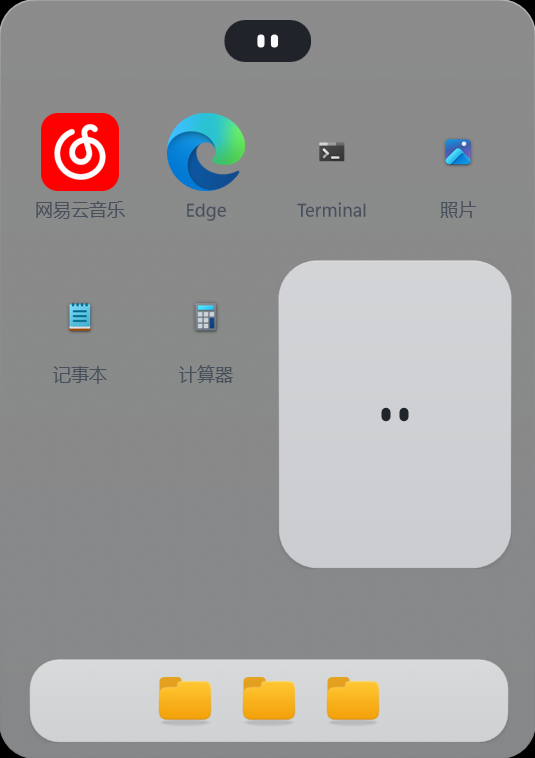
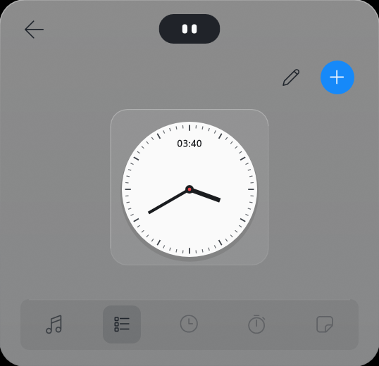
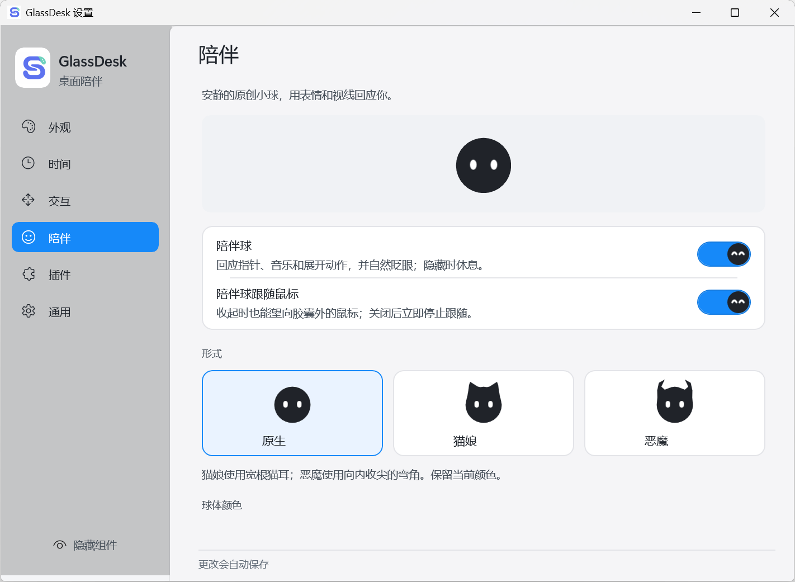
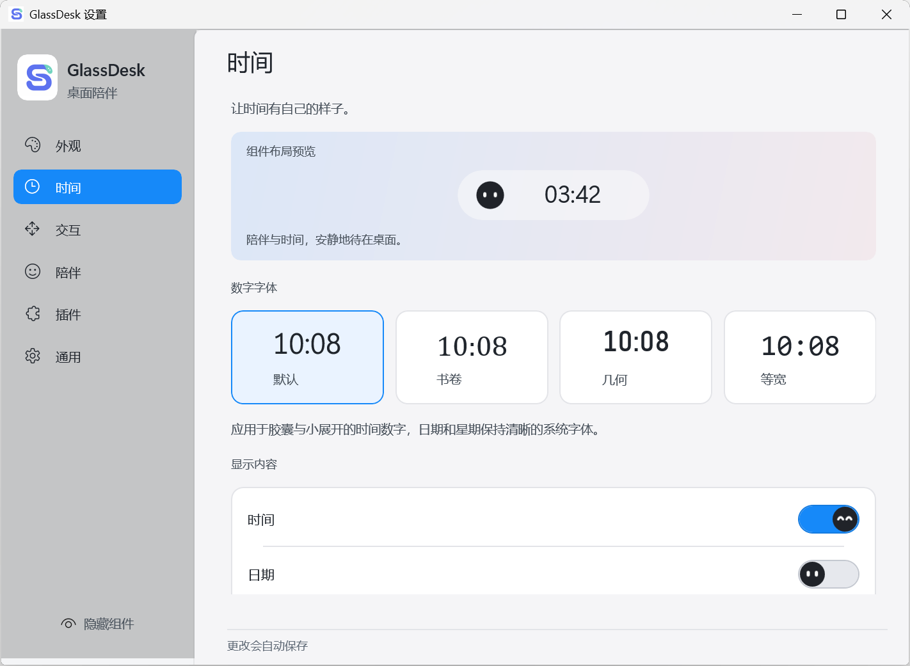
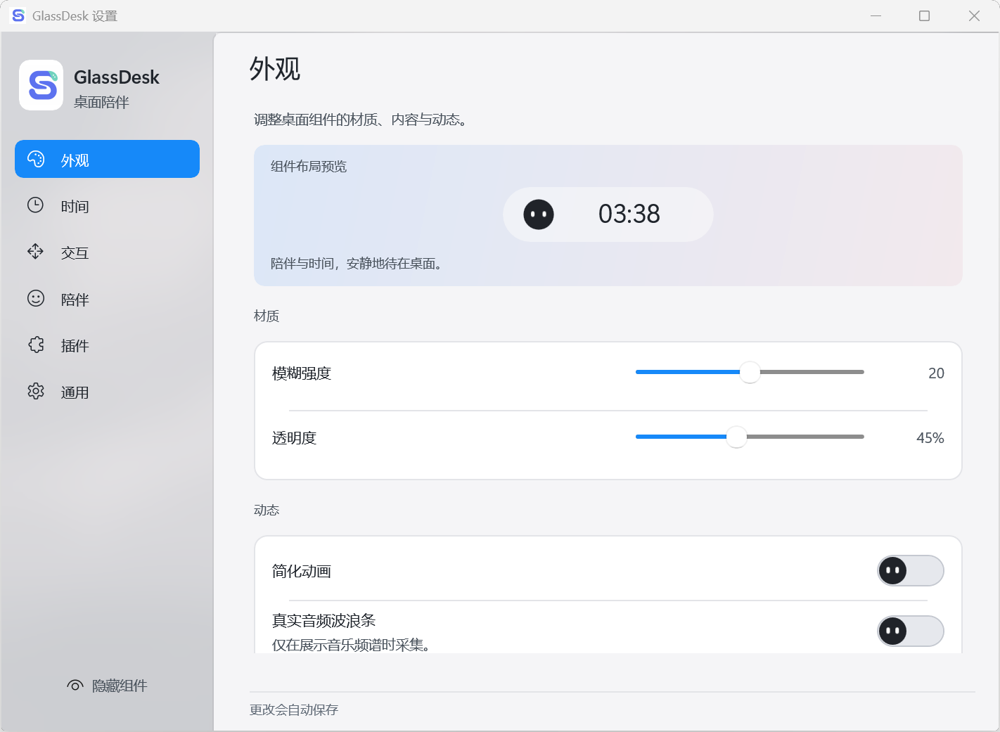

<div align="center">


# GlassDesk

**把时间、音乐和一点陪伴，放进桌面。**

面向 Windows 11 的悬浮桌面应用。

`Windows 11` · `x64` · `v0.1`

[界面预览](#界面预览) · [功能介绍](#功能介绍) · [下载应用](https://github.com/Sheng-awa/GlassDesk/releases) · [反馈问题](https://github.com/Sheng-awa/GlassDesk/issues)

<br>


</div>

<br>

GlassDesk 从一枚悬浮胶囊开始，把常看的时间、随手可控的音乐和会回应你的陪伴球，放在桌面的一角。需要时展开，不需要时收起；让桌面更有趣，也让常用操作更顺手。

## 界面预览

<table>
  <tr>
    <td align="center" width="50%"><strong>桌面首页</strong><br><sub>应用入口、文件夹与页面导航</sub></td>
    <td align="center" width="50%"><strong>时钟小组件</strong><br><sub>展开后，也有自己的桌面空间</sub></td>
  </tr>
  <tr>
    <td align="center" valign="top"></td>
    <td align="center" valign="top"></td>
  </tr>
</table>

<sub>以上为 0.1 应用窗口截图。材质呈现会随桌面背景、透明效果和系统环境变化。</sub>

## 功能介绍

### 一个会回应你的桌面伙伴

陪伴球会看向鼠标、自然眨眼，并用表情回应音乐与交互。你可以选择原生、猫耳或恶魔形式，也可以给它换一种颜色。

它既是桌面上的小角色，也是 GlassDesk 的一部分：从收起的胶囊到展开的界面，让不同状态保持熟悉的感觉。

<p align="center">
  
</p>

### 时间，也可以有自己的样子

在独立的时间设置中选择数字字体：**默认、书卷、几何、等宽**。时间、日期与星期可以分别开关，选择会同步到胶囊和音乐小展开中的时间显示。

<p align="center">
  
</p>

### 听音乐时，少切一次窗口

连接网易云音乐的 Windows 系统媒体会话后，可以查看歌曲与封面，控制上一首、播放 / 暂停和下一首。

暂停约 5 秒后，收起的胶囊会切回时间；已经展开的播放器仍保留音乐内容。恢复播放后，胶囊重新显示歌曲。

可选的音频波浪条会跟随可识别的网易云进程输出。不采集麦克风，也不保存音频。

### 从胶囊展开成一个小空间

- **首页**：常用应用入口、文件夹预览和页面导航。
- **音乐**：封面、歌曲信息与可用的播放控制。
- **小组件**：当前以离线时钟为主，可进入编辑与配置。
- **页面记忆**：关闭大展开后，再次打开会保留上次选择的实际页面。

首页应用能否打开取决于本机安装情况。导航中的预览入口不代表对应功能已经完整实现。

### 外观由你决定

调整模糊、透明度、展开延迟和动画；按需要开启液态玻璃，或使用基础磨砂材质。设置采用浅色侧栏与分组布局，更改自动保存。

也支持全屏自动隐藏、显示 / 隐藏快捷键和登录 Windows 时启动。开机启动默认关闭，快捷键默认未绑定。

<details>
<summary>查看外观设置</summary>

<p align="center">
  
</p>

</details>

### 用本地插件扩展

导入兼容的 `.glassdesk-plugin` 文件，在设置中分别启停、更新或移除。

GlassDesk 当前没有在线插件市场。插件在应用进程内运行，请只安装可信来源的插件。

## 开始使用

### 系统要求

| 项目 | 要求 |
| --- | --- |
| 系统 | Windows 11 22H2 / Build 22621 或更新版本 |
| 架构 | x64 |
| 音乐连接 | 网易云音乐，并启用 SMTC / 系统媒体控制 |
| 运行依赖 | 发布包自带，无需单独安装 .NET 或 Windows App SDK |

### 下载与运行

发布包以 [Releases](https://github.com/Sheng-awa/GlassDesk/releases) 页面实际提供的文件为准；若暂未提供下载，请等待版本上传。

1. 下载 Windows x64 发布包，**完整解压**到希望长期使用的位置。
2. 双击 `GlassDesk.exe`。
3. 首次启动会打开设置。之后可以从任务栏右下角的 GlassDesk 托盘图标进入。
4. 使用音乐功能时，在网易云音乐中播放一首歌，等待组件连接。

请保留完整应用文件夹，包含其中的 DLL、资源与子目录，不要只复制 EXE。

### 常用操作

| 想做什么 | 怎么操作 |
| --- | --- |
| 查看小展开 | 将鼠标停在组件上 |
| 打开大展开 | 点击组件的相应空白区域 |
| 收起大展开 | 点击展开区域外部 |
| 移动组件 | 拖动组件空白区域 |
| 显示、隐藏或找回组件 | 使用托盘菜单；位置异常时重置位置 |
| 更换时间字体 | 设置 → 时间 |
| 设置快捷键或开机启动 | 设置 → 通用 |
| 退出应用 | 托盘菜单 → 退出，或设置 → 通用 → 退出 GlassDesk |

关闭设置窗口只会隐藏设置，应用仍会在托盘运行。

## 常见问题

<details>
<summary>网易云音乐没有连接，怎么办？</summary>

先在网易云音乐中播放一首歌，并检查其 SMTC / 系统媒体控制选项，再到 GlassDesk 的通用设置中重新连接。封面、播放状态和时间轴能力由音乐来源提供；没有有效时间轴时，进度跳转不可用。

本版不提供网易云账号登录、歌单同步或收藏操作。

</details>

<details>
<summary>液态玻璃会影响性能吗？</summary>

液态玻璃默认关闭。开启后会采样显示器背景，增加一定的捕获与图形开销；游戏或重负载时可以关闭，继续使用基础材质。

部分截图或录屏方式可能无法捕获开启液态玻璃后的组件。环境不支持时，应用会回退基础材质并提示状态。

</details>

<details>
<summary>配置保存在哪里？更新会丢失设置吗？</summary>

配置默认保存在 `%LocalAppData%\GlassDesk`，与应用文件夹分开。更新前先从托盘退出，再替换完整应用文件夹；保留用户数据目录即可保留设置。

如果更换了程序位置且此前开启了开机启动，请在新位置重新开关一次该选项。

</details>

<details>
<summary>为什么 Windows 可能提示未知发布者？</summary>

当前 GlassDesk 自身的可执行文件尚未做代码签名。请只从可信来源获取发布包；遇到系统提示时先确认来源，不要关闭系统安全防护。

</details>

## 反馈与参与

GlassDesk 还在成长中。欢迎通过 [Issues](https://github.com/Sheng-awa/GlassDesk/issues) 提交问题、使用感受或功能建议。

反馈问题时，提供 **应用版本、Windows 版本与显示缩放、复现步骤**；界面问题最好附上截图。也可以在设置 → 通用中导出诊断，附上与问题相关的日志。公开提交前，请先检查截图与文件中是否有个人信息。

欢迎参与代码、交互、视觉和文档改进。关于新功能的大改动，可以先在 Issues 中交流想法。

<details>
<summary>从源码构建</summary>

需要 .NET SDK 10.0.401、Windows SDK 10.0.26100.0 和 MSVC x64 工具链；项目使用 Windows App SDK 2.5.1。在 Windows 开发环境中，从源码仓库根目录执行：

```powershell
.\scripts\build-native.ps1 -Configuration Release
dotnet restore .\src\GlassDesk.App\GlassDesk.App.csproj --locked-mode
dotnet publish .\src\GlassDesk.App\GlassDesk.App.csproj -c Release -r win-x64 --self-contained true --no-restore -p:GlassDeskUiPreview=false -p:PublishSingleFile=false -p:PublishTrimmed=false -o .\artifacts\publish
```

分发构建结果时，请一并保留项目许可、第三方声明和完整运行依赖。

</details>

## 许可与致谢

项目代码采用 [MIT 许可](LICENSE)。随附运行依赖及借鉴的开源组件遵循各自的许可，请参阅 [第三方声明](THIRD-PARTY-NOTICES.md) 与 `licenses` 目录。

感谢开源社区在桌面交互、矢量控件和动效探索上的分享。GlassDesk 与网易云音乐、Microsoft Edge 等第三方产品没有隶属或官方合作关系。

