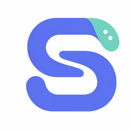
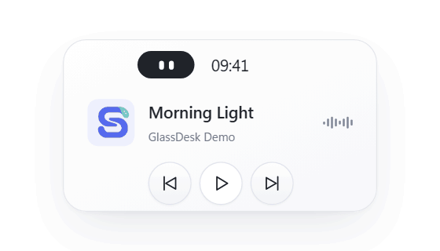

# GlassDesk

**时间，音乐。还有一点陪伴。**

Windows 11 桌面上的悬浮小伙伴 · 0.1

[下载安装包](https://github.com/Sheng-awa/GlassDesk/releases/download/v0.1.0/GlassDesk-0.1.0-win-x64-setup.exe) · [打开交互网页](https://sheng-awa.github.io/GlassDesk/) · [反馈问题](https://github.com/Sheng-awa/GlassDesk/issues)

<picture>
  <source media="(prefers-reduced-motion: reduce)" srcset="docs/images/peek.png">
  
</picture>

小展开交互演示。网页和动图使用演示曲目，实际应用显示播放器提供的歌曲与封面。

GlassDesk 把常看的时间、随手可控的音乐，和一双会回应你的眼睛，放在桌面的一角。需要时轻轻展开，不需要时安静收起。

- **一点陪伴**：陪伴球看向鼠标、自然眨眼，用表情回应你的操作。
- **听歌顺手**：查看网易云音乐的歌曲与封面，切歌、播放或暂停，少切一次窗口。
- **抬眼看时间**：选择喜欢的数字字体；暂停一会儿，收起的胶囊会把位置还给时间。

想先看看手感？[打开白底交互展示页](https://sheng-awa.github.io/GlassDesk/)，移动鼠标、点击陪伴球，也可以试试演示播放按钮。网页不会播放声音或控制本机播放器。

## 安装与使用

1. 从 [0.1 首次发布](https://github.com/Sheng-awa/GlassDesk/releases/tag/v0.1.0) 下载 **GlassDesk-0.1.0-win-x64-setup.exe**，运行安装。
2. 从开始菜单打开 GlassDesk；首次启动会打开设置。
3. 在网易云音乐中启用 **SMTC / 系统媒体控制**并播放歌曲，等待组件连接。

支持 **Windows 11 22H2（Build 22621）或更新版本，x64**。安装包自带运行依赖，无需单独安装 .NET 或 Windows App SDK。

悬停查看小展开，拖动空白区域调整位置；设置、隐藏与退出都可以从任务栏右下角的托盘菜单进入。关闭设置窗口后，应用会继续在托盘运行。

当前安装包尚未代码签名，请从本仓库 Releases 下载并确认来源。发布页提供 SHA-256 校验文件。

## 常见问题

**音乐没有连接？** 先确认网易云音乐正在播放，且已开启 SMTC / 系统媒体控制，再到设置 → 通用重新连接。封面和播放能力取决于音乐来源；本版没有账号登录、歌单同步或收藏功能。

**重负载时如何降低开销？** 液态玻璃默认关闭，可以使用基础磨砂材质，并按需关闭动态效果。液态玻璃开启后会增加背景捕获与图形开销。

**设置保存在哪里？** 默认保存在 `%LocalAppData%\GlassDesk`。卸载会保留该目录，方便重新安装后继续使用原有设置。开机启动默认关闭，快捷键默认未绑定。

发现问题时，欢迎在 [Issues](https://github.com/Sheng-awa/GlassDesk/issues) 提供 Windows 版本、显示缩放和复现步骤；界面问题可以附上截图。

## 开源与许可

项目代码采用 [MIT 许可](LICENSE)。运行依赖和第三方组件遵循各自许可，详见 [第三方声明](THIRD-PARTY-NOTICES.md) 与 [licenses](licenses)。本地插件在应用进程内运行，请只安装可信来源的插件。

GlassDesk 与网易云音乐、Microsoft Edge 等第三方产品没有隶属或官方合作关系。
